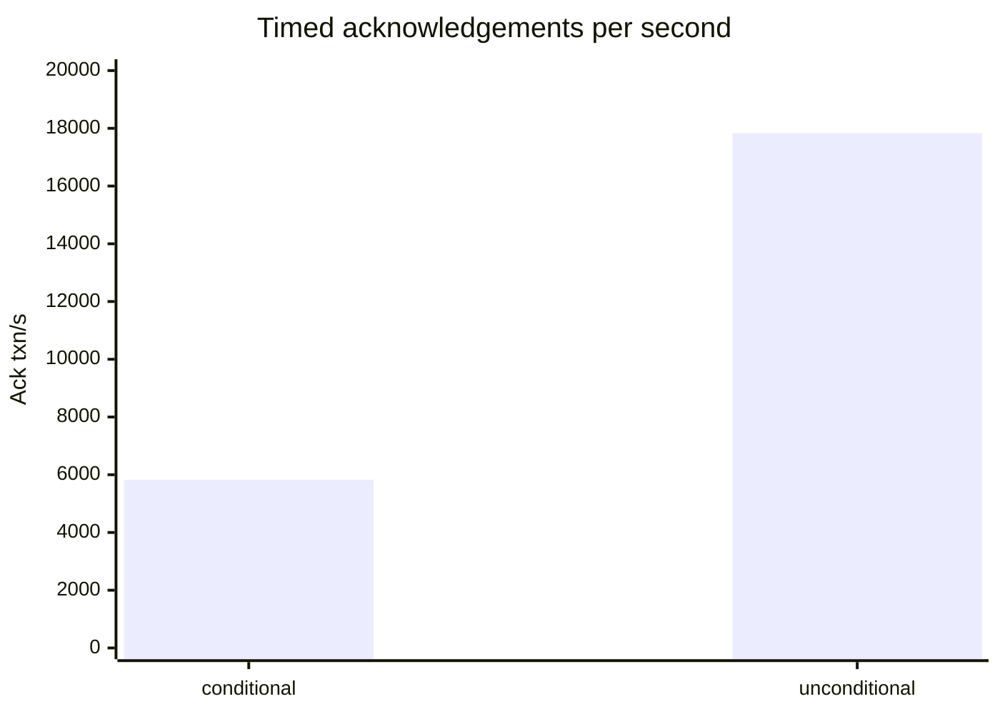

# Five native writers on separate VMs

2026-10-23: five distinct GCE VMs in `us-central1-a`, 2 vCPUs each, writing to S2 basin `logdb-bench-976641` (`aws:us-west-2`). Each mode used a fresh stream, 2,000 clients **total** (400 per writer), 10,000 accounts initially holding 1,000 each, a 30-second measurement window, and `--epoch-ms 0`.

Source: base revision `db3fde4` plus the native distributed benchmark changes (source SHA-256 `2a0d90be…`). [Host manifest](native-orbs5-20261023/hosts.json): orb URLs, distinct GCE instance IDs, node IDs, and full source hash.

Workers generate transfers through native `Node::submit`. HTTP is control/reporting only; this run forwarded it through `socat` / `tailscale nc` for userspace tailnets. No transaction traverses that forwarding path.

## Results

Throughput counts acknowledgements inside the scheduled measurement window, excluding drain. Aborted transactions count as acknowledged; request errors do not. Latency percentiles pool timed acknowledgements across workers using a 2% logarithmic histogram: percentiles are bucket upper bounds, not exact samples or averages of worker percentiles. Maxima are observed values.

| Append mode | Timed acknowledgements | Ack txn/s | p50 ms | p90 ms | p99 ms | Max ms |
|---|---:|---:|---:|---:|---:|---:|
| conditional | 174,721 | 5,824.0 | 272.46 | 404.87 | 778.25 | 14,376.01 |
| unconditional | 535,038 | 17,834.6 | 116.28 | 141.74 | 246.78 | 490.95 |



| Append mode | Drained acknowledgements | Timed aborts | Drain aborts | Epochs | Lost races |
|---|---:|---:|---:|---:|---:|
| conditional | 2,000 | 50 | 3 | 453 | 1,703 |
| unconditional | 2,000 | 3,694 | 44 | 1,462 | 0 |

Epoch/race counters include load and drain, excluding seeding. Abort columns are subsets of the respective acknowledgement counts.

Timed acknowledgements by worker, in report order (node IDs change between runs):

| Worker | conditional | unconditional |
|---|---:|---:|
| 1 | 45,426 | 116,241 |
| 2 | 34,562 | 100,063 |
| 3 | 48,120 | 101,632 |
| 4 | 2,467 | 99,540 |
| 5 | 44,146 | 117,562 |

Conditional appends were severely unfair: worker 4 completed only 2,467 timed acknowledgements. These are single runs per mode at one writer count, not a scaling study.

## Verification

Both runs passed: all five writers had identical final sequence/hash, exactly 10,000 nonnegative integer balances totaling 10,000,000, and no request or append errors. Applied transactions equal 10,000 seed operations plus every acknowledgement, including drain and aborts.

| Append mode | Final next sequence | State hash (hex) | Applied transactions per writer |
|---|---:|---|---:|
| conditional | 455 | `1cba4e06196a4162` | 186,721 |
| unconditional | 1,464 | `f7048881a57aa1ff` | 547,038 |

Machine-readable reports: [conditional.json](native-orbs5-20261023/conditional.json), [unconditional.json](native-orbs5-20261023/unconditional.json). Console reports: [conditional.txt](native-orbs5-20261023/conditional.txt), [unconditional.txt](native-orbs5-20261023/unconditional.txt).

## Reproduce

Build with `cargo build --release`. Synchronize all host clocks. Export `S2_API_KEY` and `S2_BASIN` on each writer host. Choose one append mode and a shared fresh stream name; restart all workers with a new stream for the other mode.

On each of five writer hosts, with matching `MODE` and `STREAM`:

```bash
MODE=conditional                    # repeat with unconditional
STREAM=bench-UNIQUE-conditional      # same fresh stream on all five hosts
CONTROL_BIND=127.0.0.1               # forward control, or use a trusted tailnet IP
./target/release/logdb bench-worker --log s2 --basin "$S2_BASIN" \
  --stream "$STREAM" --append "$MODE" --epoch-ms 0 --listen "$CONTROL_BIND:7100"
```

Expose each unauthenticated control endpoint only to the trusted coordinator (forwarding is required for loopback/userspace tailnets). Set `W1` through `W5` to their reachable HTTP origins, then run:

```bash
MODE=conditional
./target/release/logdb bench \
  --worker "$W1" --worker "$W2" --worker "$W3" --worker "$W4" --worker "$W5" \
  --clients 2000 --accounts 10000 --seconds 30 --output "$MODE.json"
```
